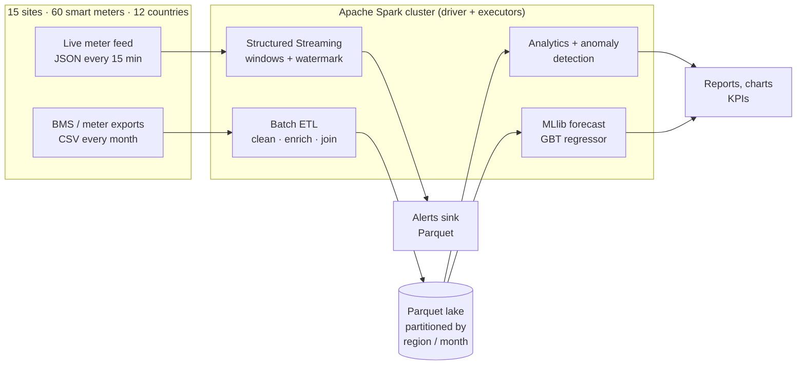
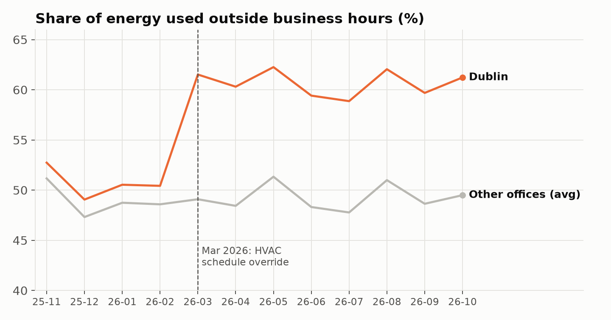
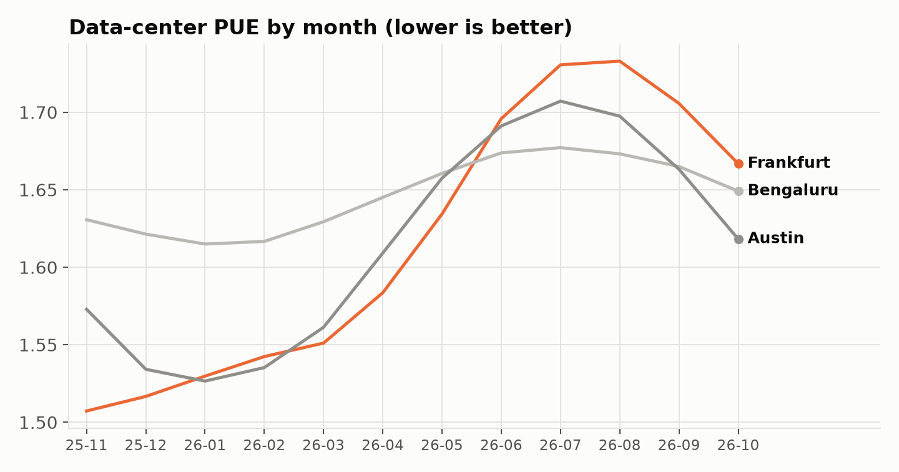
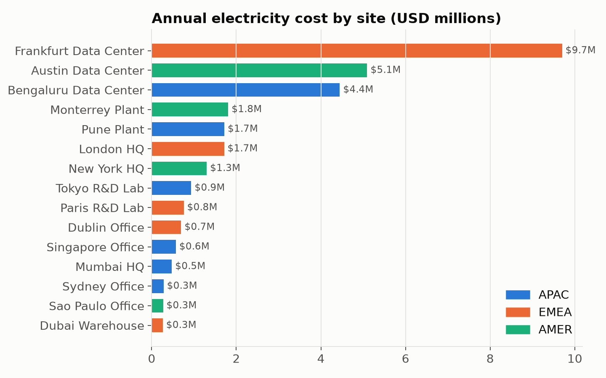
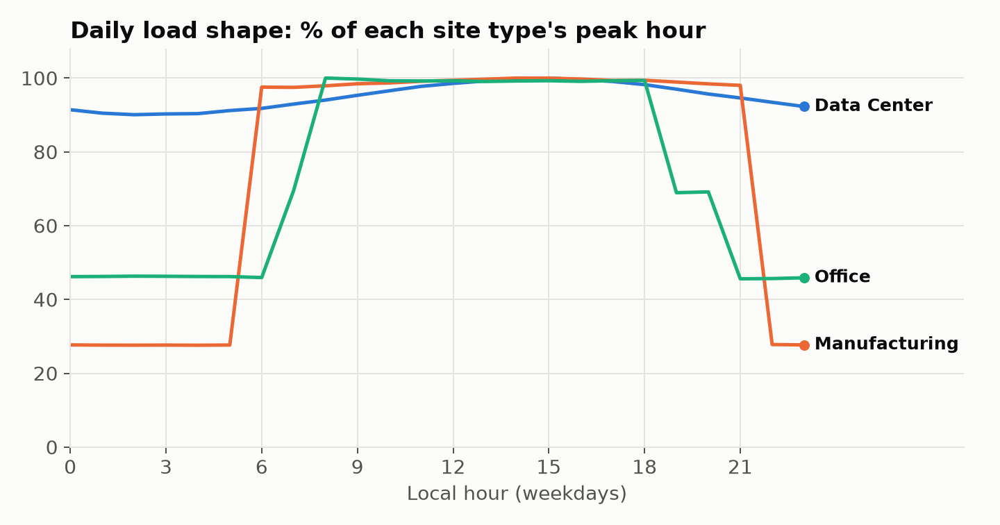
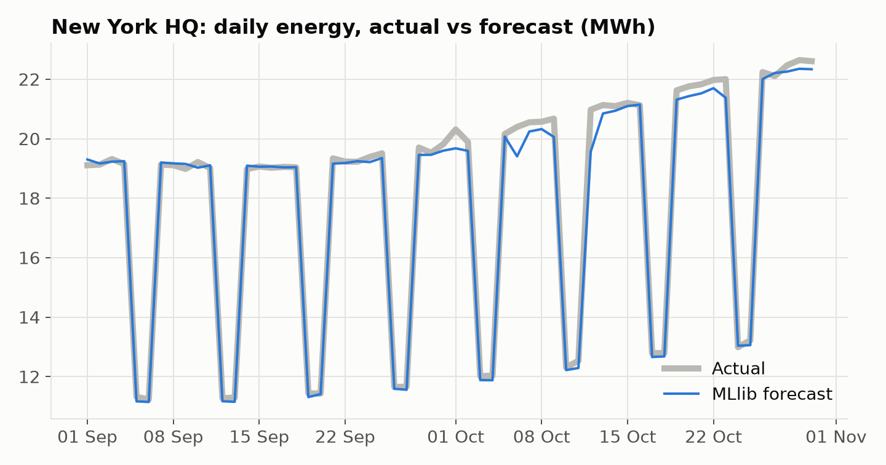

# A Distributed System for Energy Monitoring of a Multinational Company

**Apache Spark 4.0 · PySpark · Spark SQL · Structured Streaming · MLlib · Parquet**

A multinational company runs 15 sites (offices, data centers, factories, R&D labs and a
warehouse) in 12 countries. Each site has its own meters, time zone, electricity tariff and
grid carbon intensity. This project collects their 15-minute smart-meter data in one place
and uses Apache Spark to:

1. **Clean** messy meter exports (nulls, sign errors, duplicates) and report data quality.
2. **Enrich** each reading with site metadata, local time, cost (USD) and carbon (kg CO2).
3. **Store** a curated data lake in Parquet, partitioned by `region` and `year_month`.
4. **Analyse** consumption by site, region, month, category and hour; energy intensity
   (kWh/m²), after-hours waste and data-center PUE.
5. **Detect anomalies**: demand spikes (window-function z-scores) and dead meters
   (gaps-and-islands on zero readings).
6. **Forecast** next-day energy per site with an MLlib Gradient-Boosted Trees model.
7. **Monitor live** with Structured Streaming: 15-minute windows, watermarks, and alerts
   when a site exceeds its contracted demand.

## Architecture



| Layer | Implementation |
| --- | --- |
| Ingestion | `spark.read.csv` with an explicit schema (180 files, read in parallel) |
| Data quality | single-pass aggregate + `groupBy` duplicate check + `left_anti` join for unknown sites |
| Enrichment | **broadcast join** with the site dimension, `from_utc_timestamp` per site time zone |
| Storage | Parquet, `partitionBy("region", "year_month")` for partition pruning |
| Analytics | Spark SQL aggregations, `rank()` over region windows, percentile demand |
| Anomalies | `Window.partitionBy(meter, hour, weekend)` z-scores; row-number gaps-and-islands |
| ML | `Pipeline(StringIndexer → OneHotEncoder → VectorAssembler → GBTRegressor)` |
| Streaming | file source (Kafka-ready), stream-static join, `withWatermark`, tumbling `window`, `foreachBatch`, checkpointing |

## Results (one year, 2.1 million readings)

| Metric | Value |
| --- | --- |
| Sites / meters / regions | 15 / 60 / 3 (APAC, EMEA, AMER) |
| Raw readings | 2,108,700 in 180 CSV files (120 MB) |
| Bad rows removed | 11,476 (4,143 nulls, 1,045 negative, 6,300 duplicates) |
| Energy | **219,269 MWh** |
| Cost | **$30.0 million** |
| Carbon | **103,473 t CO2** |
| Demand spikes flagged | 1,093 (≈ $57,000 of excess cost) |
| Meter faults | Pune production meter dead for 47.75 hours (14–16 Jul 2026) |
| Forecast accuracy | MAPE **0.97 %** vs 1.47 % for a naive "same day last week" baseline (R² 0.9998) |
| Batch runtime | ≈ 75 s end to end on a laptop (`local[*]`, 8 cores) |

### Findings the pipeline surfaced

**Dublin's HVAC started running 24/7 in March 2026.** After-hours share jumped from
50.6 % to 60.7 % while other offices stayed flat: 329.5 MWh and about **$98,900** wasted in
eight months.



**Frankfurt went from the best data-center PUE to the worst** (1.51 → 1.67 year on year,
peak 1.73), while Bengaluru and Austin barely moved. Frankfurt is also the most expensive
site ($9.7 M a year) because German power costs about $0.24/kWh.



**Data centers use two thirds of all energy** (66.8 %), so a 0.1 PUE gain there is worth
more than switching off every office light.



| | |
| --- | --- |
|  |  |

All result tables are in [`results/`](results/).

## Project layout

```
config/sites.json          site dimension: region, type, timezone, tariff, CO2 factor, capacity
src/common.py              SparkSession factory, schemas, paths
src/generate_data.py       synthetic meter data with planted faults (numpy/pandas)
src/transforms.py          all Spark transformations (pure functions, unit-tested)
src/batch_pipeline.py      batch ETL + analytics + anomaly detection
src/forecast_model.py      MLlib GBT forecast
src/stream_simulator.py    emits live meter readings as JSON files
src/streaming_monitor.py   Structured Streaming demand monitor + alerts
src/make_charts.py         charts (docs/images) and insights.json
tests/test_transforms.py   pytest suite on small DataFrames
docker-compose.yml         1 master + 2 worker standalone Spark cluster
```

## How to run

Requires Python 3.10+ and Java 17 or 21.

```bash
python -m venv .venv && source .venv/bin/activate
pip install -r requirements.txt

make all          # generate data → batch ETL → forecast → charts  (≈ 3 min)
make stream       # live demo: simulator + streaming monitor (≈ 1 min)
make test         # unit tests
```

Or step by step:

```bash
python src/generate_data.py          # 2.1 M readings → data/raw/readings
python src/batch_pipeline.py         # → data/curated (Parquet) + results/*.csv
python src/forecast_model.py         # → results/forecast_*.{json,csv}
python src/make_charts.py            # → docs/images/*.png, results/insights.json
```

### Running on a real cluster

The same code runs unchanged on a cluster; only the master URL changes.

```bash
docker compose up -d                                   # master UI: http://localhost:8080
docker compose exec spark-master bash -c \
  "cd /opt/project && SPARK_MASTER=spark://spark-master:7077 \
   /opt/spark/bin/spark-submit src/batch_pipeline.py"
```

On YARN, Kubernetes, Databricks or EMR, set `SPARK_MASTER` (or pass `--master` to
`spark-submit`) and point `EM_DATA_DIR` at HDFS/S3. For production streaming, replace the
file source with Kafka: `spark.readStream.format("kafka").option("subscribe", "meter-readings")`.

## Notes

- Data is **synthetic** but realistic: occupancy schedules per site type, temperature-driven
  HVAC, hemisphere-aware seasons, local time zones. Tariffs and grid carbon factors are
  approximate public figures, for illustration.
- Three problems are planted on purpose (Dublin HVAC override, Frankfurt cooling drift, Pune
  meter fault) to show the pipeline finds them without being told where to look.
